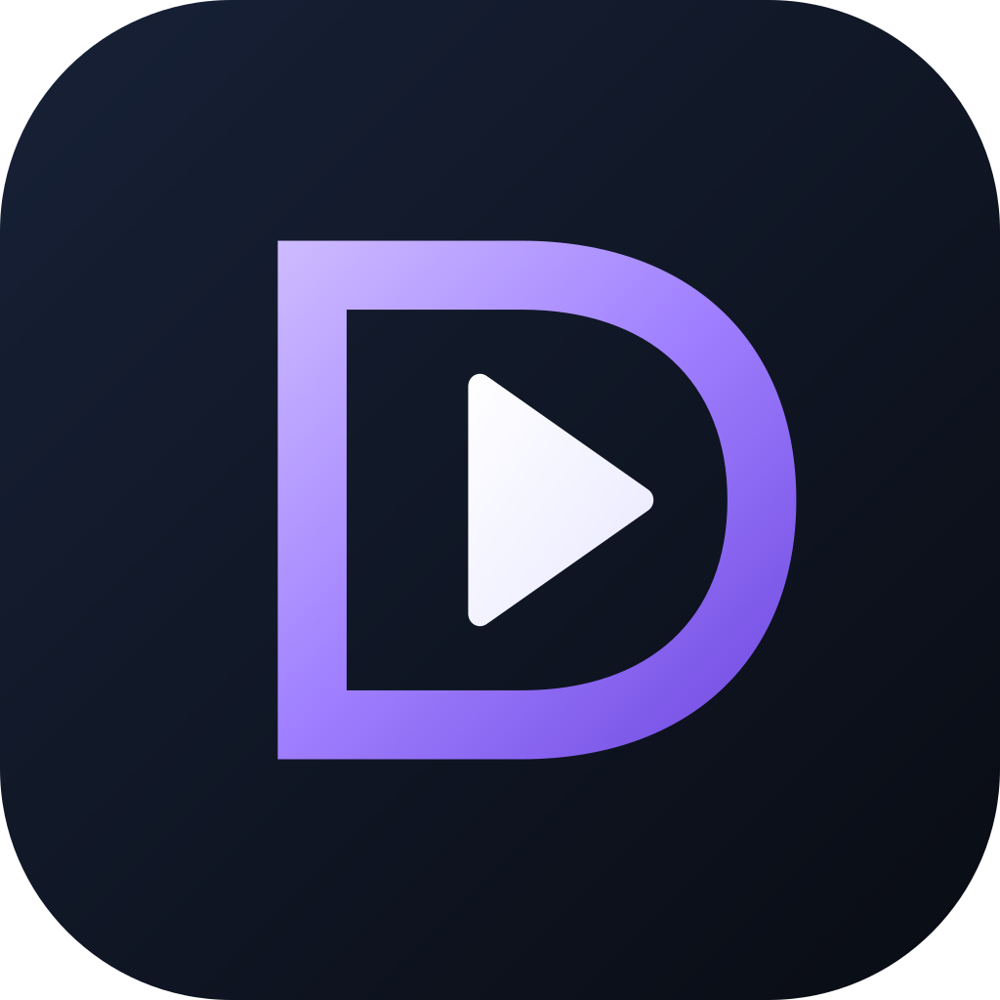

# DD desktop icon family



Issue [#7](https://github.com/jimbobsmith/drivedeck-desktop/issues/7), approved by the maintainer on 2026-10-20. The original DD D-frame/play artwork distinguishes the FreeTube-derived desktop fork from upstream. Its violet frame and ice-white play mark share the silhouette of the blue/mint Android sibling ([Player #20](https://github.com/jimbobsmith/drivedeck-player/issues/20)). These are provisional product assets under the repository's existing AGPL licence. All FreeTube credits, licences and third-party notices remain.

## Source and generation

`dd-desktop.svg` is the approved editable 108-unit artwork (1024px output). `theme-colors.json` preserves the inherited contrast colours for each header theme. The header uses a cropped, tile-free mark for legibility in the existing 25px space. The launcher/window/tray retain the approved rounded tile. Text wordmarks remain inherited; this bounded artwork change does not migrate app names, IDs, profiles, protocols, signing or update identity.

```powershell
node tools/branding/generate.cjs <absolute-path-to-sharp-module>
```

Sharp is a separately supplied authoring tool, not a new project dependency. Recorded generation uses Node 24.18.0, Sharp 0.35.5 and librsvg 2.63.2. Normal production builds consume the committed assets without requiring Sharp.

The generator writes Linux SVG, Electron window/tray PNG, 22 header/theme SVGs, the existing web-manifest icon and Windows/macOS containers. ICO contains PNG entries at 16/24/32/48/64/128/256px. ICNS contains 11 modern PNG representations including Retina and 1024px. Each container entry is independently decoded and compared with the approved source rendering. Original app source, package configuration, dependencies and frozen lockfile are unchanged.

## Validation and limits

See [evidence.json](evidence.json) for source, tool and artifact hashes. Use the unchanged [baseline build recipe](../BASELINE.md) with `pnpm run lint` and `pnpm run build` (publish never). The build produces unsigned local Windows x64 unpacked/ZIP/7z/NSIS/portable artifacts. No installer is executed.

Visual checks cover small launcher sizes and theme variants. Packaged checks inspect the executable's icon resources and the exact window/tray PNG in app.asar. A fresh-profile packaged UI smoke verifies the loaded DD header mark and captures the actual app; its pre-start guard suppresses external protocol registration and isolates user/session/log/crash paths exactly as the baseline harness does. The app keeps its normal sandbox and security policy. This smoke does not request media playback or qualify provider/A/V/recovery behavior.

Regeneration is checked for identical outputs. Native macOS/Linux packaging/runtime, Windows shell cache refresh, installed shortcuts and tray presentation remain unobserved field checks. The ICO/ICNS structural/pixel checks do not establish OS acceptance on those untested systems. Merge, personal installation, identity migration, signing and publication remain separate actions.
